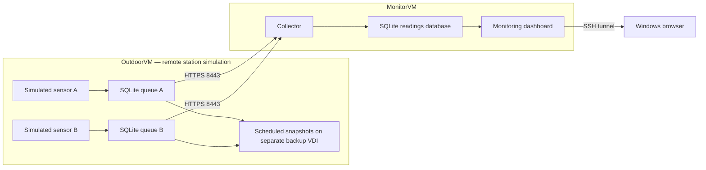
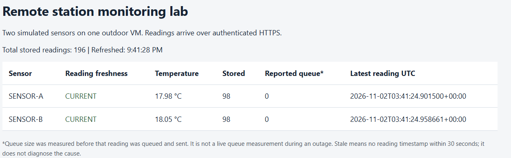
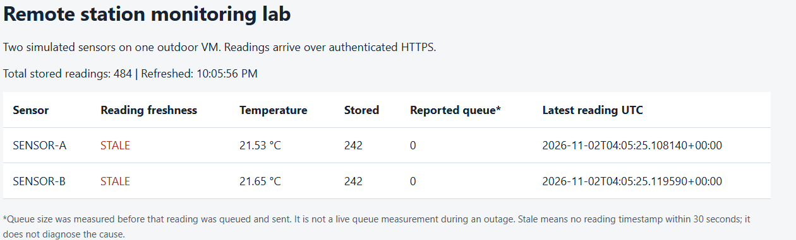
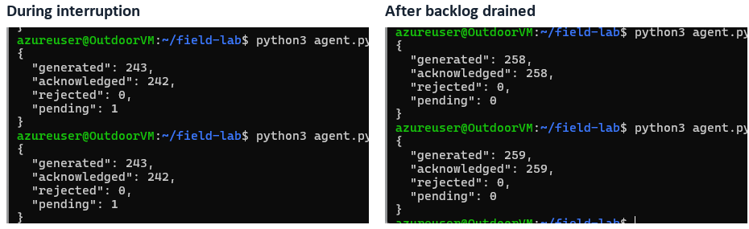
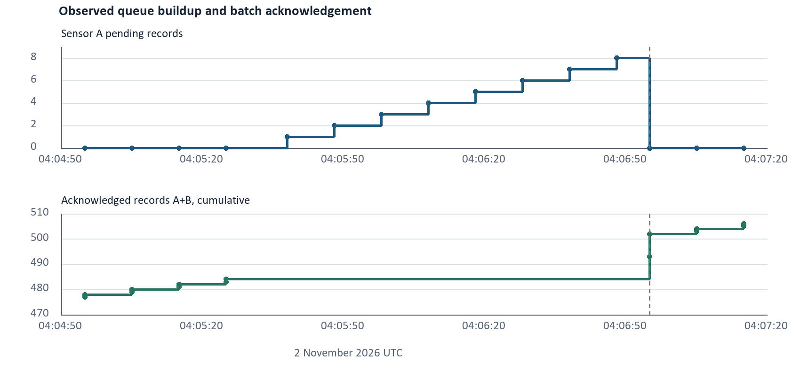

# Remote Device Recorder and Monitoring Lab

A two-VM Ubuntu lab that preserves recorded sensor data through connection outages and synchronizes it when communication returns.

I used VirtualBox to simulate a remote recording station and a separate monitoring server. Two simulated sensor processes maintain their own persistent SQLite queues. A collector receives readings over authenticated HTTPS, and a dashboard shows sensor freshness and recorded counts. Scheduled snapshots on a second virtual disk support queue restoration.

**[Read the complete lab report](reports/Remote_Device_Recorder_Lab_Report.pdf)** · **[Setup and reproduction](docs/REPRODUCE.md)** · **[Source scripts](scripts/)**

The [self-contained HTML report](reports/Remote_Device_Recorder_Lab_Report.html) can be downloaded and opened locally; its screenshots enlarge when clicked.

## Verified results

| Check | Result |
|---|---|
| Collector export | **879 readings, 879 unique IDs** |
| Outdoor journal reconciliation | **All 867 IDs logged as queued appear in the later collector CSV** |
| Selected backup restoration | **4 pending IDs restored and found at the collector; 0 missing** |
| Outage buffering | Both agents reached **8 pending records**, then each acknowledged a batch of **9** |
| Sensor continuity | Sensor B kept reporting while Sensor A was stopped |
| Automatic process restart | Journals show recovery after signal-9 terminations in **6 seconds** and **5 seconds** |
| VM reboot recovery | Successful, confirmed during the project |

The journal and collector exports were taken at different times. The later collector export includes six additional records per sensor, explaining the difference between 867 and 879.

## Architecture



| Device | Lab address | Role |
|---|---|---|
| Windows host-only adapter | `192.168.56.1` | SSH administration |
| OutdoorVM | `192.168.56.101` | Two simulated sensors, persistent queues and backups |
| MonitorVM | `192.168.56.102` | Collector and dashboard |

Each VM used 2 vCPUs and 2 GB RAM. OutdoorVM had a primary virtual disk plus an 8 GB backup VDI. NAT provided outbound access; host-only networking carried lab traffic.

## How it works

1. Generate a reading with a unique ID and UTC timestamp.
2. Save it to the local SQLite outbox before delivery.
3. Send queued readings to the collector over verified HTTPS.
4. Commit records at the collector and acknowledge the saved IDs.
5. Remove acknowledged IDs from the agent queue.
6. Create versioned queue snapshots for controlled restoration.

The two sensors are processes on one VM. Their temperatures are simulated. The backup disk is a separate guest filesystem, and snapshots run approximately every 30 seconds with three versions retained per sensor. After acknowledged delivery, the collector holds the ongoing record.

## Selected evidence

### Baseline



### During a connection outage



The dashboard retains its last received queue value during an outage. Local counters and journals establish the actual backlog:





### Backup restoration


Additional screenshots and their explanations are in the PDF report.

## Run the offline tests

The scripts use Python's standard library. From the repository root:

```bash
cd scripts
python3 tests.py
```

The seven offline tests cover queue retention, acknowledgement handling, retry deduplication, capacity limits, snapshot restoration/retention, dashboard freshness, token validation and evidence export. Network transport is simulated in these unit tests. Live project outcomes are documented separately in the report.

## Repository contents

```text
reports/          PDF and offline HTML report
docs/             Setup reference and selected evidence images
scripts/          Python agents, collector, dashboard, backup and recovery tools
```

## My contribution

I deployed and configured the Linux VMs, networking, firewall rules, services and backup storage; ran controlled outage, sensor interruption and restoration exercises; and collected the screenshots and exported results. The project deployed and tested a monitoring lab using AI-assisted Python scripts, configuring Linux networking, services, storage, and backup recovery. The report documents the procedures, actual observations and record-ID reconciliation.

**Author:** Saeed Hersi · [GitHub](https://github.com/960hersi)
